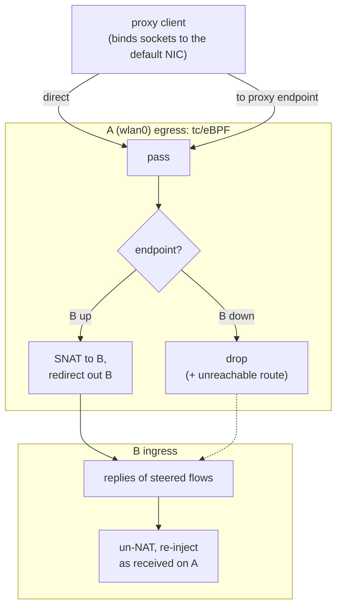

# sinan

sinan or "司南" is a small program that keeps proxy traffic off an untrusted Wi-Fi by steering it through phone tethering, while everything else keeps using the Wi-Fi. You can also use sinan with proxy clients or networking tools.

| Uplinks present                      | What sinan does                                      |
|--------------------------------------|------------------------------------------------------|
| untrusted Wi-Fi **A** + tethering **B** | proxy endpoints → B, everything else → A          |
| A only                               | proxy endpoints blocked, everything else → A         |
| anything without A (B, trusted Wi-Fi C, Ethernet, BT…) | system default behavior |

## Use

Requires Linux ≥ 6.6 (TCX).

```sh
go generate ./internal/steer # If you changed steer.go
go build -o sinan ./cmd/sinan
sudo install -m755 sinan /usr/local/bin/
sudo install -Dm644 contrib/config.example.yaml /etc/sinan/config.yaml    # edit it
sudo sinan -check    # shows detection & endpoint table, and verifies eBPF
sudo install -m644 contrib/sinan.service /etc/systemd/system/
sudo systemctl enable --now sinan
```

`systemctl reload sinan` (SIGHUP) re-reads sources and re-resolves domains; source files are also re-read automatically when they change.

## How it works

"Proxy traffic" is defined by destinations of connections to a proxy *server*. The proxy client still decides per connection whether to go DIRECT or through a node. sinan only makes sure the
node connections never leave through A.



### FAQ

#### Why eBPF rather than policy routing?
proxy clients with `auto-detect-interface` bind every outgoing socket to one NIC (`SO_BINDTODEVICE`), and routing can't move bound sockets. The two TCX programs (`internal/steer/bpf/steer.c`) do so transparently, so the client's socket stays happy on A.


#### Why endpoints rather than GeoIP
many nodes are domestic relays, so a "proxied → B" rule would send exactly the inspected traffic over A.

## Limits

- Classification is only as good as the endpoint list. A node address sinan
  doesn't know (e.g. the client resolved a node domain to an address sinan's
  DNS never returned) is treated as direct. Point `dns` at the client's
  `proxy-server-nameserver`.
- Steering needs Ethernet-framed A and B. That covers Wi-Fi, RNDIS/NCM, iPhone
  and Bluetooth PAN. A family B lacks (e.g. no IPv6) is blocked instead.
- Steered flows use A's MTU. ICMP errors for them (PMTU) are not translated,
  and IP fragments to endpoints are dropped.
- If sinan is killed with SIGKILL, its default route stays until the next
  start (the systemd unit restarts it), and the eBPF guard is gone
  until then.
